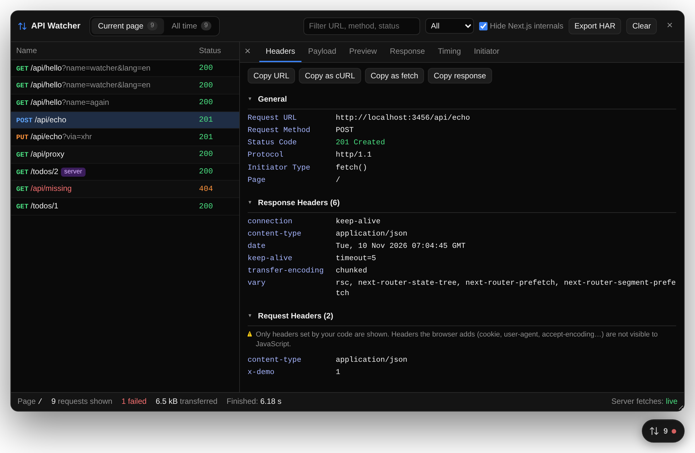
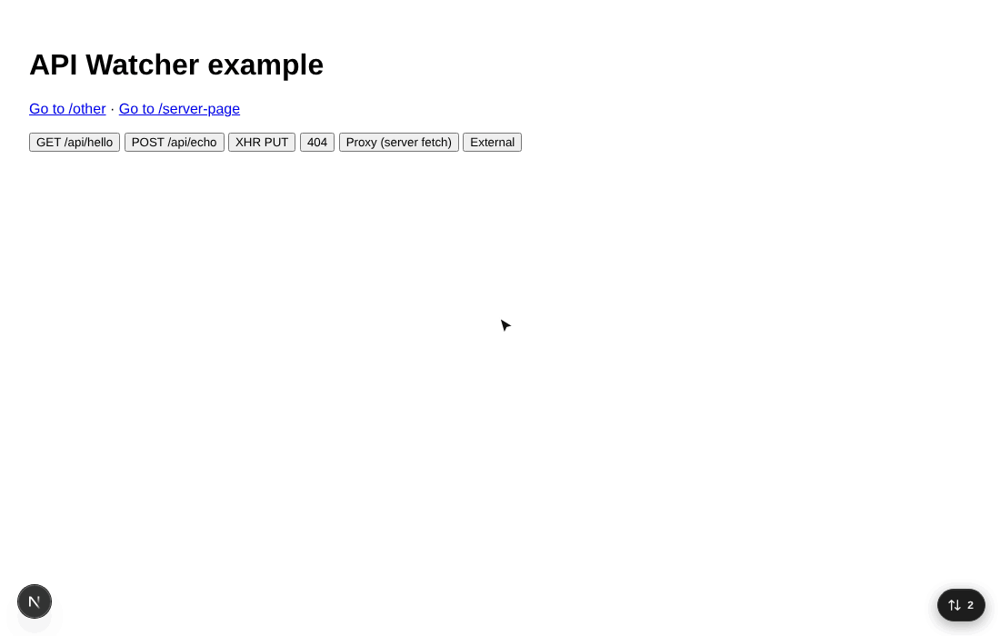

# nextjs-api-watcher

A floating, **dev-only** API inspector for Next.js, in the style of the Next.js dev indicator. Click the badge to see every `fetch()` and `XMLHttpRequest` your app makes, with the same details as Chrome DevTools' Network tab. It can also show the `fetch()` calls your **server** makes.



- **Current page**: requests made on the page you're on, including server-side fetches made while rendering it or while handling API routes it called. The list resets on client-side navigation.
- **All time**: every API call this browser tab has seen, kept across full page reloads. Calls are grouped by endpoint with call counts, error counts, average time and the pages they were called from. You can drill down into an endpoint or view the flat list.
- **Server-side fetches** (optional setup): `fetch()` calls from Server Components, Route Handlers and Server Actions appear next to the browser's, tagged `server`.
- **Export HAR**: download the requests shown as a HAR 1.2 file, which you can open in Chrome/Firefox DevTools, Charles, Proxyman and similar tools.
- **Request details**: General info, response and request headers, payload (query string, JSON, form data), JSON preview tree, raw response, timing breakdown (DNS / connect / SSL / TTFB / download), sizes, and the initiator call stack.
- **Actions**: Copy as cURL, Copy as fetch, copy URL and copy response, plus filtering by URL, method, status, failed requests, or browser vs. server.
- **Zero cost in production**: renders nothing, and the watcher code is removed from production bundles.



## Install

```bash
npm i -D nextjs-api-watcher
```

## Usage

### App Router

```tsx
// app/layout.tsx
import { ApiWatcher } from 'nextjs-api-watcher';

export default function RootLayout({ children }: { children: React.ReactNode }) {
  return (
    <html lang="en">
      <body>
        {children}
        <ApiWatcher />
      </body>
    </html>
  );
}
```

`ApiWatcher` is a client component, so you can render it directly from a Server Component layout.

### Pages Router

```tsx
// pages/_app.tsx
import type { AppProps } from 'next/app';
import { ApiWatcher } from 'nextjs-api-watcher';

export default function App({ Component, pageProps }: AppProps) {
  return (
    <>
      <Component {...pageProps} />
      <ApiWatcher />
    </>
  );
}
```

### Server-side fetches (optional)

Browsers can't see requests your server makes, so the server side needs two small files.

**1. Record server fetches** in [`instrumentation.ts`](https://nextjs.org/docs/app/guides/instrumentation) at the project root (or in `src/`):

```ts
// instrumentation.ts
export async function register() {
  if (process.env.NEXT_RUNTIME === 'nodejs' && process.env.NODE_ENV === 'development') {
    const { registerApiWatcher } = await import('nextjs-api-watcher/server');
    registerApiWatcher();
  }
}
```

**2. Expose them to the panel** with a route handler:

```ts
// app/api/api-watcher/route.ts
export { GET } from 'nextjs-api-watcher/server';
```

Pages Router only? Use an API route instead:

```ts
// pages/api/api-watcher.ts
export { pagesApiHandler as default } from 'nextjs-api-watcher/server';
```

The panel footer shows the connection state: `live`, `not set up` (the route is missing) or `not registered` (the route exists, but `registerApiWatcher()` wasn't called). If you mount the route somewhere else, pass `serverEndpoint="/your/path"`.

Each server fetch records the page or API route it ran for (for example `/blog/hello`, route `/blog/[slug]`), its request and response headers and bodies, timing, any `next.revalidate` / `next.tags` options, and the server-side call stack.

`registerApiWatcher(options)` accepts `ignore`, `maxBodySize` and `bufferSize` (default 500 requests buffered until the browser picks them up).

## Options

| Prop                | Type                                                         | Default          | Description                                                                 |
| ------------------- | ------------------------------------------------------------ | ---------------- | --------------------------------------------------------------------------- |
| `position`          | `'bottom-right' \| 'bottom-left' \| 'top-right' \| 'top-left'` | `'bottom-right'` | Corner for the floating button. The Next.js indicator sits bottom-left.     |
| `initialOpen`       | `boolean`                                                    | `false`          | Open the panel on first load. The open/closed state is remembered per tab.  |
| `hideNextInternals` | `boolean`                                                    | `true`           | Hide RSC payloads, prefetches, server actions and HMR traffic. Can be toggled in the UI. |
| `ignore`            | `(string \| RegExp)[]`                                       | `[]`             | URLs to skip entirely (substring or regex match).                           |
| `maxRecords`        | `number`                                                     | `1000`           | Max individual requests kept in memory. Endpoint call counts are never evicted. |
| `maxBodySize`       | `number`                                                     | `1048576`        | Max characters of each request/response body kept.                          |
| `persist`           | `boolean`                                                    | `true`           | Keep "All time" in `sessionStorage` so it survives reloads (per tab). The **Clear** button on that tab resets it. |
| `serverEndpoint`    | `string \| false`                                            | `'/api/api-watcher'` | Route serving server-side fetches. `false` disables it. See below for automated browsers. |

```tsx
<ApiWatcher position="bottom-left" ignore={['/analytics', /sentry\.io/]} />
```

Keyboard: `Esc` closes the request detail, then the panel.

### Export HAR

The **Export HAR** button downloads whatever the current view shows: the current page, all requests, or one endpoint's calls, after your filters. Server-side entries carry a `comment` naming the page or route they ran for. Request bodies and timings are included. Response bodies are included as long as they're under `maxBodySize`.

### Persistence across reloads

With `persist` on (the default), finished requests and endpoint counts are saved to `sessionStorage`, so they last until the tab closes. sessionStorage holds about 5 MB; when it fills up, the oldest response bodies are dropped first, then the oldest requests. Endpoint call counts are always kept. "Current page" still starts fresh after a reload.

### Automated browsers (Playwright, Cypress, Puppeteer)

Server sync keeps one long-poll request open, which would stop `waitUntil: 'networkidle'` from ever resolving in end-to-end tests run against `next dev`. So when `navigator.webdriver` is true, server sync is **off** unless you pass `serverEndpoint` explicitly. The browser-side watcher keeps working, because it makes no requests of its own.

## How it stays out of production

The component checks `process.env.NODE_ENV === 'development'` inline. Next.js replaces that expression at build time, so in `next build` the check becomes `false` and the bundler drops the UI and the interceptors as dead code. This is verified with both Turbopack and webpack builds. Nothing is patched and nothing is rendered in production, even if the component stays in your layout.

On the server, `registerApiWatcher()` does nothing outside development, and the `/api/api-watcher` route returns `404` in production.

## Limitations

These are browser limits, and Chrome's own network tab has the same ones:

- **Server-side capture covers `fetch()` only.** Libraries that use `node:http` directly (axios in Node, many database clients) aren't captured. Fetches served from Next's data cache aren't shown either, because they never hit the network. With the Pages Router, server fetches are recorded, but without the page they ran for.
- **Server sync uses one long-poll request.** It shows up in the dev server log roughly every 50 seconds and whenever new server fetches arrive.
- **Request headers the browser adds itself** (cookies, `user-agent`, `accept-encoding`, …) aren't visible to JavaScript. Only headers set by your code are shown.
- **Cross-origin responses** only expose CORS-safelisted headers, plus any listed in `Access-Control-Expose-Headers`. Detailed timing needs `Timing-Allow-Origin`; without it, the watcher shows its own measured TTFB and download time.
- `EventSource`, `WebSocket`, `navigator.sendBeacon` and resource loads (images, scripts) aren't intercepted.
- "All time" lives per browser tab (sessionStorage). New tabs start empty.

## Development

```bash
npm install
npm run build      # build to dist/
npm run dev        # rebuild on change
npm run typecheck
```

The `example/` folder is a small Next.js app for manual testing:

```bash
npm run build && npm pack
cd example && npm i ../nextjs-api-watcher-*.tgz && npx next dev
```

## License

MIT
